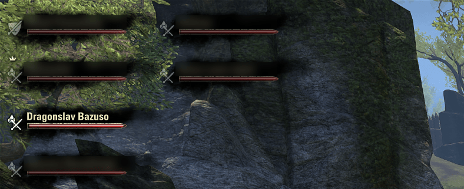

# Added Info - Unit Frames

More from the game's own group frames (the vanilla UI, no replacement frames):

- **Health bar colors by role:** tank, healer and damage dealer can each get their own color, and your own bar can differ from the rest. Presets plus a custom color.
- **Large frames for groups of up to 12.** The game switches to small raid frames above 4 players; here groups of up to 12 keep the large group frames. With **Small Group As Grid** on, they are laid out in 4 rows × 3 columns and sorted by role: tanks, healers, damage dealers, then players without a role. Good for three 4-player groups in a trial or a PvP group.
- **Class icon and CP after the name** (option, off by default): `John Doe <class icon> 1234`, or the level below 50.
- **No overland difficulty icon after names** (option, on by default).
- **Resurrection status** (option): "Being Ressed..." or "Pending..." instead of just "Dead".

## Settings

*Settings → Addons → Added Info - Unit Frame (AIUF)*

## Things to know

- Companion frames are turned off for the whole UI. The addon replaces the game's companion functions for the group (`GetCompanionUnitTagByGroupUnitTag`, `GetNumCompanionsInGroup`, `HasActiveCompanion`), which other addons see too.
- The 12-player threshold also moves the game's large-group warning when you invite players.
- Groups larger than 12 (the game allows up to 24) use the original raid layout, 2 columns of 12, which doesn't match the game's subgroups.
- Not compatible with addons that replace the unit frames.

## Credits

Fork of [Added Info - Unit Frames](https://www.esoui.com/downloads/info2771-AddedInfo-UnitFrames.html) by **MrPikPik**, last updated in 2021. The first commit in this repository is the unmodified 1.3.3; the changes are in the following commits:

- groups of up to 12 use the large frames; the grid is 4 × 3 instead of 2 × 2 and sorted by role;
- the frame block no longer jumps on group changes and zone loads (the game stretched its anchor to 12 rows, and the anchor is kept on screen);
- one frame not being created yet no longer stops the whole layout;
- the resurrection status also works in groups of 5 to 12;
- the class icon / CP and difficulty icon options;
- the rainbow preset's ("F-ing RGB") 100 ms timer only runs while a role uses that preset;
- companion frames off.

## Requirements

- LibAddonMenu-2.0
