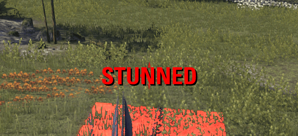
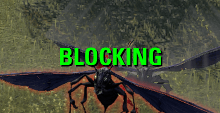

# Am I Stunned?

A big, unmissable label in the middle of the screen that tells you what is holding you back right now:

| Label | Meaning |
|---|---|
| **STUNNED** (red, with a sound) | You're stunned. Break free! |
| **ROOTED** (orange) | You can't move, but you can still act. |
| **BLOCKING** (green) | You're holding block and your stamina/magicka regen is zero because of it. Let go if you don't need it. |
| **BLOCKING** (orange) | Both blocking and rooted. |

 

## Why another stun indicator?

Because the game's own information about crowd control is very unreliable. `EVENT_PLAYER_STUNNED_STATE_CHANGED` and the other crowd-control events and status checks fire late, fire twice, miss stuns entirely, or report a stun that has already ended. The alternative, recognizing every stun-applying ability and debuff one by one, means hundreds of abilities that change every patch.

After a lot of trial and error, this addon uses the one signal that turned out to be reliable: the game's **Active Combat Tips** (the "Break free!" / "Rooted" prompts). They are checked against whether your action bar is actually locked out:

- Stunned = the "break free" tip is shown **and** your skills can't be used.
- Not stunned anymore = the tip is gone, or your skills can be used again (whichever is first).
- Rooted = the "rooted" tip is shown, until it's gone or you're clearly moving again.

For this to work, Active Combat Tips must be set to **Always**. The addon sets this at every login. If they get turned off, for example in the game's settings, you get a warning in chat. You don't have to look at the tips: the *Hide Active Combat Tips* option hides them on screen while keeping them working.

## Settings

*Settings → Addons → Am I Stunned?*

- **Hide Active Combat Tips:** keeps the tips working but invisible.
- **Show outside of combat:** off by default; stuns and roots outside of combat are usually not interesting.
- **Unlock UI:** drag the label anywhere. **Reset to default position** puts it back just above the center of the screen.

## Requirements

- LibAddonMenu-2.0
