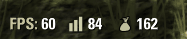

# Bag Watcher

Shows your free backpack space next to the game's FPS and latency meters, so you notice a full bag before the loot starts disappearing.

The number is white above 50 free slots, yellow above 15 and red below that.

It also recolors the latency bars to a neutral color, so they don't look like a warning.

The performance meters must be turned on (*Settings → Interface → Show Framerate / Show Latency*).

