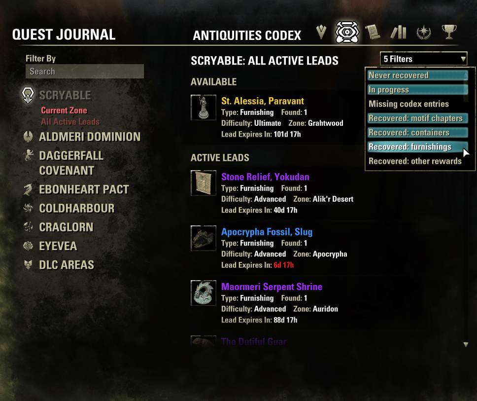

# Decluttered Scrying Leads

The *Antiquities → Scryable → All Leads* list shows every antiquity you can scry, including the ones you've dug up a dozen times already that only give a furnishing you have. This addon adds a filter dropdown to that list, so it shows only what's worth digging.

## The filter dropdown

It sits at the top right of *Scryable → All Leads* (Current Zone is left as it is). It works like the filter dropdown in the housing furniture browser: tick any number of entries, and the list updates when the dropdown closes.

- **Never recovered**
- **In progress**
- **Missing codex entries** (antiquities whose codex you haven't completed)
- **Recovered: motif chapters**
- **Recovered: containers**
- **Recovered: furnishings**
- **Recovered: other rewards** (collectibles, mythic fragments and anything else)

An antiquity is shown if it matches any ticked entry. With nothing ticked, you get the game's full list. Default: never recovered, in progress, motif chapters and containers.

Your choice is saved for the whole account. The game's own rules still apply on top (for example, All Leads only lists antiquities you have a lead for, if one is needed).

The reward type is read from the reward item itself, so the addon works in every game language.

### With tim99's Colored Lists

Colored Lists adds its own **Missing Codex** checkbox to All Leads. That option is part of this dropdown, so the checkbox is hidden (and unticked, if it was ticked). To get the same list as with that checkbox, tick only **Missing codex entries**.

## Changes in 2.0

- The filter dropdown is new. 1.x always applied a fixed filter (motif chapters and containers) to All Leads only.
- The reward type is read from the item instead of the English reward text.
- The game's lead rule is kept. 1.x also showed never-recovered antiquities you had no lead for.

## Requirements

None.
