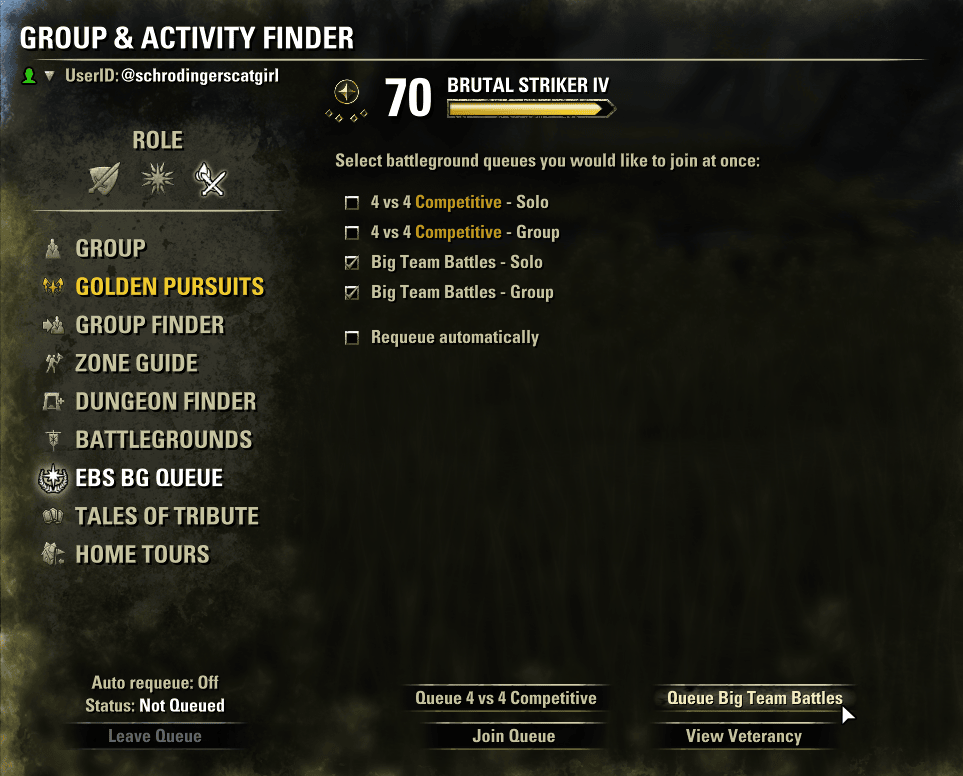

# Even Better Scoreboard

A battlegrounds addon: a more informative scoreboard and a faster way to queue.

## Credits and history

This addon is based on **Better Scoreboard** by **M0R** (@M0R_Gaming), which added damage, healing and class icons to the battlegrounds scoreboard and a multi-queue selection.

It started as a patch on top of Better Scoreboard (*BetterBetterScoreboard*). Over time the changes ended up overriding almost all of the original logic, so a patch no longer made sense and it became a separate addon. Better Scoreboard isn't required. Disable it, BetterBetterScoreboard and BattlegroundModeSaver: all of them hook the same game controls, and this addon does what they did.

<!-- screenshot: scoreboard in a 6v6v6 match -->

## Scoreboard

- **Damage and healing** next to each player's score, plus **class icons**.
- The game's own Damage, Heals and flag columns (added in 12.1.5) are hidden again, and the window keeps its narrower width.
- **Big lobbies fit without a scrollbar** (9v9, 6v6v6, 8v8). The list grows with your screen height, and if that's still not enough, rows are packed closer together.
- **One name per row**, chosen by the setting below (by default, the game's own "Prefer character names" setting).

## Queuing

An **EBS BG Queue** tab in the Group & Activity Finder, right after Battlegrounds:

- **Queue several battleground types at once** with checkboxes. Your selection is remembered between sessions. The list updates by itself when a queue unlocks or a weekly event starts or ends.
- **Quick buttons** such as *Queue 4v4 Competitive* or *Queue Big Team Battles*: one click selects the solo and group versions of that queue and joins.
- Your **battleground rank** and XP bar, as on the Battlegrounds screen.
- **Requeue automatically** *(off by default, resets on every reload)*. If you decline a ready check, you are queued again for the same battlegrounds once the cooldown is over. A ready check that times out, or leaving the queue yourself, never requeues you.
- **Cooldown timer**. After declining or missing a ready check, the Finder's "Status: Queued" text shows how long until you're allowed to queue again, and the Join Queue button stays disabled until then.

The buttons and checkboxes are disabled whenever the game wouldn't let you queue anyway: already queued, mid ready check, using the Group Finder, or on cooldown.

If you prefer the game's own Battlegrounds screen, it now **remembers the last selected mode** across reloads (account-wide).

## Settings

*Settings → Addons → Even Better Scoreboard* (needs LibAddonMenu-2.0; without it everything runs with the defaults)

- **Player name display:** game setting, @account, character name, or both, in either order.
- **Remember last battleground mode in vanilla finder** (on).
- **Show quick queue buttons** (on).
- Colors for Competitive and Standard queues and for damage and healing numbers.

All settings are account-wide and apply immediately.

## Changelog

See [changelog.txt](changelog.txt).
