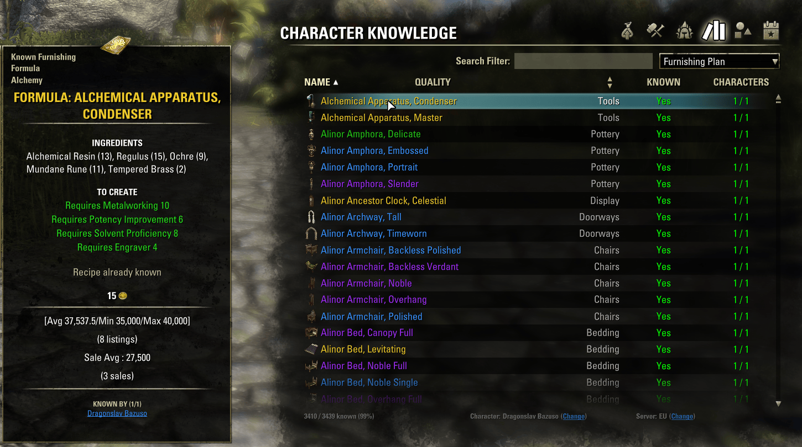

# Extra TTC Tooltips

**Tamriel Trade Centre** adds prices to most item tooltips, but misses two places where furniture shows up. This addon adds the TTC price there too:

- the **Retrieve** list of the housing editor (furniture you've placed),
- **Character Knowledge**'s browser of furnishing plans, recipes and motifs.

Each can be turned off in *Settings → Addons → Extra TTC Tooltips*.

## Requirements

- Tamriel Trade Centre
- LibAddonMenu-2.0
- Optional: Character Knowledge
