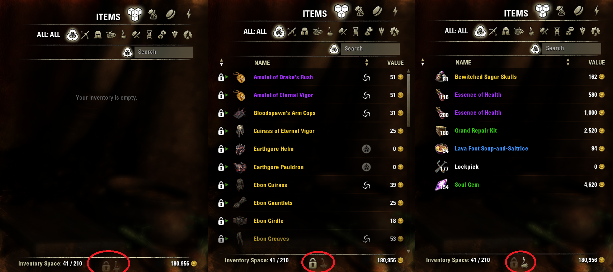

# Hide Inventory Clutter

Most players carry a few gear sets and a stack of consumables everywhere. You know they're there, so you don't need to scroll past them every time you open a bag. This addon adds two small buttons that hide them, and it trims vendor and deconstruction lists down to the items that matter.

## The buttons

The buttons appear next to the item list in the inventory, bank, mail, trade, guild store and vendor windows, and at crafting stations. A faded button means the items are hidden; click it to show them.

**Lock button:** what it hides depends on where you are.

| Where | Hidden while the button is faded |
|---|---|
| Inventory, bank and house storage deposit, bank withdraw | Locked items |
| Vendor (sell) | Items not worth selling (see below) |
| Deconstruction and enchanting extraction, including the deconstruction assistant | Items not worth deconstructing (see below) |

**Consumables button** hides items you always carry, in the inventory, bank, guild bank, mail, trade, guild store and vendor windows:

- food and drinks, potions, poisons
- lockpicks, Grand Repair Kits, soul gems

Stolen items are never treated as consumables.

Everything starts hidden whenever you log in or reload the UI.

## Worth deconstructing?

At a deconstruction or extraction station, an item is shown only if deconstructing it is worth more than selling it to a vendor. The deconstruction value is the expected market price of the materials it gives back (style material, improvement material, trait material, glyph runes). It comes from **LibDeconValue**, using prices from Tamriel Trade Centre.

Crafted items (gear you made yourself, glyphs you made) are never shown, so you can't deconstruct them by accident.

The comparison can be made stricter in the settings. This is useful without ESO Plus, when every material takes bag space:

- **Value multiplier:** deconstruction must be worth at least N times the vendor price.
- **Minimum material price:** materials cheaper than N gold don't count toward the value.
- **Minimum difference:** deconstruction must be worth at least N gold more than the vendor price.

## Worth selling?

At a vendor, the sell list shows items that are better sold than deconstructed. It leaves out crafting materials and lures, furnishings, recipes, motifs, fish, runebox fragments, crafted gear and anything the vendor won't buy. Treasures are always shown.

[DoItAll](https://www.esoui.com/downloads/info690-DoItAllMassExtractDeconstructMoveMailattach....html) works well with this addon. It deconstructs or sells exactly what is in the filtered list, so check the list before you use it.

## Settings

*Settings → Addons → Hide Inventory Clutter*

- Turn each filter on or off: locked items, consumables, materials (vendor), deconstruction.
- The three "No ESO+ mode" sliders described above.
- **Button position:** *Unlock icon position*, drag the buttons where you want them, then *Save new position*. *Reset position* puts them back in the inventory's bottom bar.

## Requirements

- LibFilters-3.0
- LibAddonMenu-2.0
- LibDeconValue (and its dependency LibPrice; Tamriel Trade Centre for prices)
