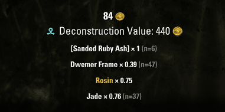

# LibDeconValue

A library that estimates what an item is worth **deconstructed** compared to **sold to a vendor**. Item tooltips get an expected-yield line, and addons can ask for the numbers. [Hide Inventory Clutter](../HideInventoryClutter) uses it to show only items worth deconstructing (or selling).



## Credits

LibDeconValue started from **[ESO-LibLootStats](https://github.com/otac0n/ESO-LibLootStats)** by **otac0n**. The item link parsing, the deconstruction model and the tooltip code come from there. LibLootStats also collected statistics on deconstruction results; that part was removed and later replaced with the learning mode described below.

The base chances and the table of materials by item level and CP come from **DeconOrSell** by **Saint-Ange**.

## What it calculates

For gear and glyphs that can be deconstructed, the expected yield is:

- base material (more for intricate items, more for items you crafted yourself),
- style material,
- improvement material (by quality),
- trait material (for jewelry: pulverized fragments; 10 of them refine into one trait material),
- runes for glyphs,
- Transmute Crystals for reconstructed items.

Each material is valued at its market price via **LibPrice**, which reads whichever price addon you have installed (Tamriel Trade Centre, Master Merchant and others). The sum is compared with the vendor price.

Items that can't be deconstructed are worth 0: stolen items, companion gear, items the game marks as non-deconstructable.

## Tooltip

Deconstructable items get a line with the expected materials and total value. The value is red when the vendor pays more, and green when the materials are worth more than the item's own market price.

## Learning mode

How often deconstruction returns style, improvement and trait materials isn't published anywhere, and the built-in chances are only community estimates. So LibDeconValue records what **your** deconstructions actually return (including the deconstruction assistant and DoItAll) and blends it with the built-in guess. After about 10 recorded items of a kind, your own results count as much as the guess.

Results are kept separately per crafting skill, item origin (loot, intricate, crafted, reconstructed) and your passives (Extraction rank, Meticulous Disassembly), because those change the odds. Only running totals are stored, not a history.

`/ldv`: status and your current passives
`/ldv stats [filter]`: recorded results, e.g. `/ldv stats BS:imp`
`/ldv on` / `/ldv off`: turn learning on or off (on by default)
`/ldv reset`: forget all recorded results

## For addon authors

```lua
-- expected market value of the materials, in gold
-- minMatPrice (optional): ignore materials cheaper than this
local deconValue  = LibDeconValue:GetDeconValue(itemLink, minMatPrice)
local vendorValue = LibDeconValue:GetVendorValue(itemLink)
```

## Requirements

- LibPrice
- Optional: Tamriel Trade Centre (or another price source supported by LibPrice), LibLazyCrafting (glyph runes), AwesomeGuildStore (tooltips in the guild store)
