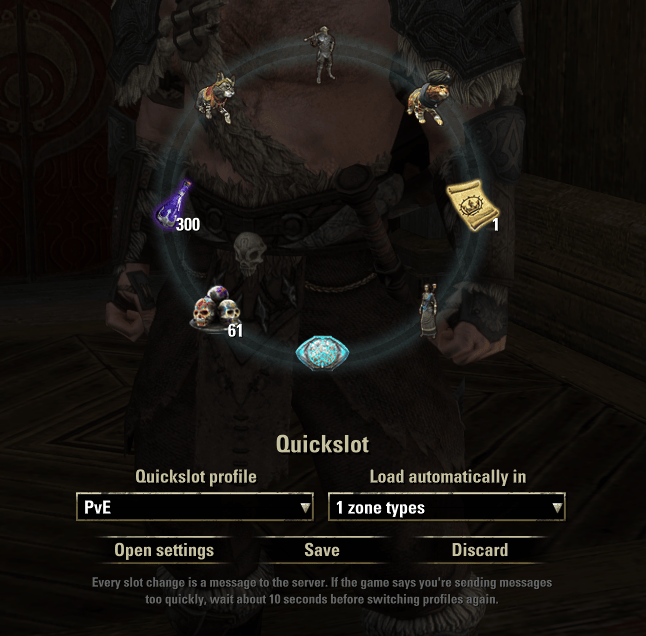

# Quickslot Profiles

Profiles for the quickslot wheel that load by themselves in the zone types you choose. Keep siege and repair kits on the wheel in Cyrodiil, potions and food in trials, and mementos in houses, without rebuilding the wheel every time.

## Profiles and zone types

Each profile is a name, the 8 wheel slots and the zone types it loads in. A loading screen puts the profile of the zone type you're in on the wheel:

| Zone type | |
|---|---|
| Battlegrounds | |
| Imperial City | The Imperial City and its sewers. |
| Cyrodiil | Including Cyrodiil's delves. |
| Infinite Archive | |
| Arenas | Maelstrom Arena, Dragonstar Arena, Blackrose Prison, Vateshran Hollows. |
| Trials | |
| Group dungeons | |
| Houses | |
| Delves and public dungeons | Outside Cyrodiil. |
| Everything else | Overland, and every zone type that no profile has. |

A zone type belongs to one profile only: picking it for one profile takes it away from the other. If no profile has "Everything else", zone types without a profile leave the wheel as it is.

A profile stores items, collectibles (assistants, companions, mementos...), emotes, quick chat and quest items.

## Editing a profile

Profiles are edited in the game's own quickslot menu, the inventory's **Quickslots** tab, with the usual drag and drop. Under the wheel:

- **Quickslot profile** (left): pick a profile and it goes on the wheel, exactly as saved (empty slots included).
- **Load automatically in** (right): the zone types this profile loads in. Applied when the list closes.
- **Open settings**, **Save** (keeps the wheel as the profile) and **Discard** (puts the saved profile back). Save and Discard light up when the wheel differs from the profile.

Picking another profile or leaving the tab drops unsaved changes (the chat says so), and the profile of the zone you're in goes back on the wheel. Opening the tab loads the profile again, so it also fills slots after restocking.

The **Edit slots** button in the settings opens the tab with the selected profile.

Items that aren't in your bag can't go on the wheel. While you edit, their slots are empty and the chat lists them. If you don't put anything else in such a slot, Save keeps the item in the profile.

Every slot change is a message to the server; switching profiles back and forth quickly can bring up the game's "sending messages too quickly" warning. Wait about 10 seconds before switching again. Slots that already hold the right thing aren't touched.

## Loading

- Items are taken from the backpack. A slot whose item isn't there (used up, left in the bank) keeps whatever it had, and the chat lists what's missing.
- **Clear slots that are empty in the profile** (on by default): an empty slot in the profile empties the wheel's slot. Off: such slots keep whatever was there.
- Right after a loading screen, missing items are looked for once more 2 seconds later before they're reported.
- In combat the wheel can't be changed. The profile loads when combat ends.

## Settings

`/qsp` or *Settings → Addons → Quickslot Profiles*

- **Profile**, **Name**, **Slots** (what the profile holds).
- **Edit slots**, **New profile** (starts from the wheel as it is now), **Delete profile**.
- **Zone types**: which profile loads where.
- **Clear slots that are empty in the profile**, **Chat message when a profile loads** (account-wide).

Profiles are per character.

## Coming from CyroQuickslots

On the first login with Quickslot Profiles, if CyroQuickslots is enabled, the character's PvE, Cyrodiil and Imperial City profiles are imported (PvE becomes "Everything else"), and a Battlegrounds profile starts as a copy of PvE. Then disable CyroQuickslots, both would swap the quickslots. Each character imports its own profiles on its first login, so keep CyroQuickslots enabled until you have logged in on every character you want to import.

## Credits

Inspired by [CyroQuickslots](https://www.esoui.com/downloads/info3134-CyroQuickslots.html) (Gerrit), itself based on Static's Quickslot Profiles. Written from scratch, no code from either.

## Requirements

- LibAddonMenu-2.0
