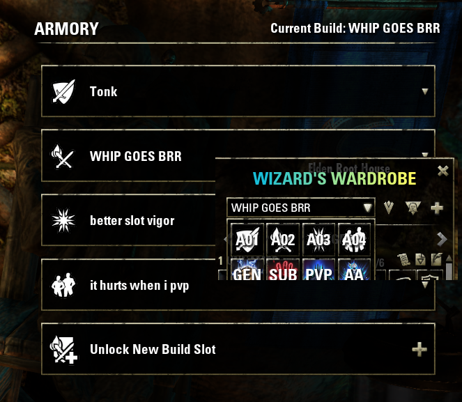

# Schrodi's Wardrobe

An add-on for **Wizard's Wardrobe** that makes it work together with the game's **Armory**.

Wizard's Wardrobe keeps setups per zone: a page for each trial and dungeon, plus a general page. If you switch whole builds through the Armory (different class mix, different role), one general page isn't enough. This addon gives every Armory build its own page.

## What it does

- **A page per Armory build.** Every unlocked Armory build gets its own Wizard's Wardrobe page (*A01*, *A02*, ...), named and iconed like the build.

  

- **The Armory picks the page.** Restoring or saving a build at the Armory switches Wizard's Wardrobe to that build's page. Outside of trials and dungeons, Wizard's Wardrobe shows the page of the build you last used.
- **Entering a trial or dungeon never loads a setup on its own.**
  - With Wizard's Wardrobe's *auto-equip* on, it switches to the zone's page but **doesn't** load its first setup. Loading the wrong setup (or skills) by accident, and triggering the CP cooldown, is worse than loading one yourself.
  - With *auto-equip* off, it stays on the Armory build's page.
- **Missing skills.** When a setup contains a skill that isn't purchased yet, or a morph you haven't picked, it can buy or morph it for you (costs skill points). Otherwise you get a chat message.
- **Teleport button inside instances.** Inside a trial, dungeon or arena that Wizard's Wardrobe knows, its teleport button switches to that zone's page instead of teleporting.

## Settings

*Settings → Addons → Schrodi's Wardrobe*

- **Saving a build also switches to it** (on)
- **Setup to load after restoring a build** (0 = off): loads setup *n* of the build's page right after an Armory restore, e.g. for food or prebuffs. The Armory already restores gear, skills and CP.
- **Auto-purchase skills** / **Auto-morph skills** (on)
- **Teleport button switches page inside instances** (on)

## Commands

- `/sw` or `/schrodi`: shows which build and page are active
- `/sw build <n>`: treat build *n* as the equipped one and show its page
- `/sw settings`: opens the settings

(`/sw` is only registered if no other addon uses it.)

## Requirements

- Wizard's Wardrobe 1.23.2 or newer
- LibAddonMenu-2.0
