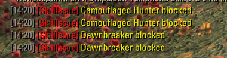

# Skill Issue

Stops chosen skills from being cast, so a misclick can't waste them:

- **Always**: e.g. a skill you only keep on the bar for its passive.
- **Only out of combat**: e.g. ultimates and long cooldowns you don't want to burn while walking around town.
- **Only in combat**: e.g. a skill you only use to prebuff.

When a blocked skill is pressed, nothing happens, and you get a chat message (can be turned off).

## Settings

*Settings → Addons → SkillIssue*

For each of the three lists there is an *Add Skill* and *Remove Skill* dropdown. *Load from skillbars* fills the *Add* dropdowns with the skills on both of your bars.

## Requirements

- LibAddonMenu-2.0
