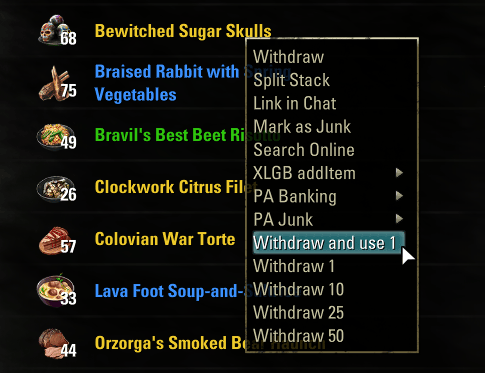

# Split and Withdraw

Adds quick amounts to the right-click menu of item stacks:

- **In your bag:** *Split 1 / 2 / 3 / 5 / 10 / 25 / 50 / 100*, which moves that many into a new stack without the quantity dialog.
- **In the bank:** *Withdraw 1 / 2 / ...*, which takes that many into your bag.
- **Food, drinks, crown items and group repair kits in the bank:** *Withdraw and use 1*, which takes one and uses it as soon as you close the bank.

Only amounts that make sense for the stack size are shown. Withdrawn items are stacked with what you already have, in the bag and in the bank.

Based on StackMaster. Made to help players without ESO Plus manage crafting materials in the bank.

## Requirements

- LibCustomMenu
